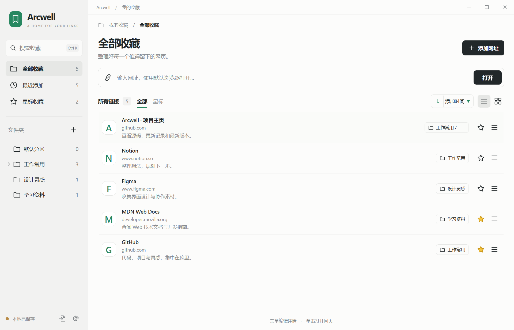
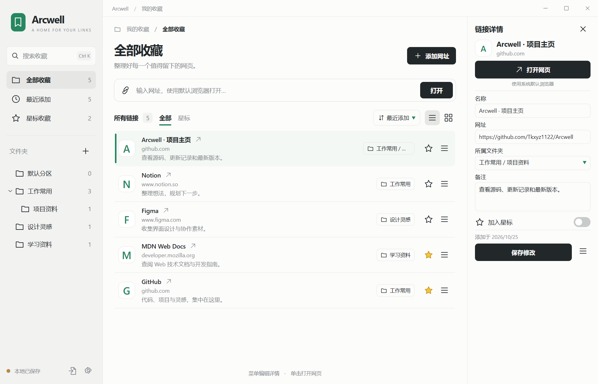
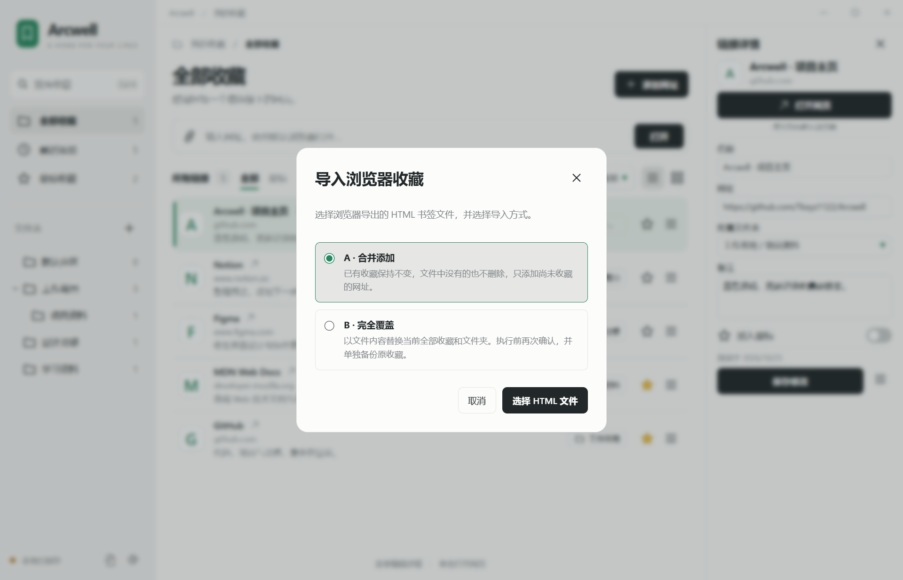
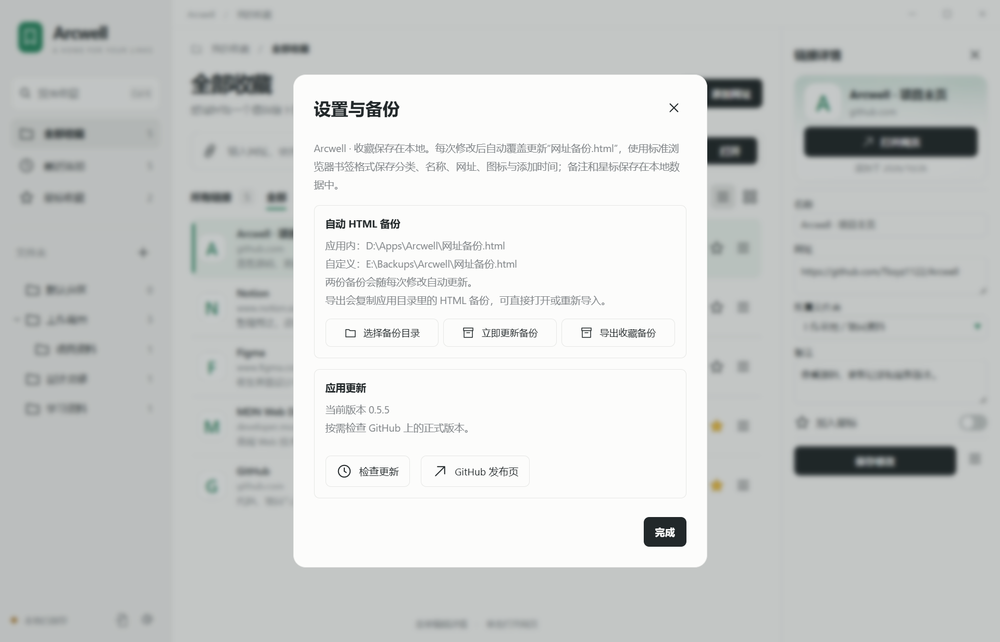

# Arcwell

<p align="center"></p>
<p align="center"><strong>A quiet home for your bookmarks.</strong><br />把常用网站、工作资料和灵感网页，整理成自己的桌面收藏库。</p>
<p align="center">
<a href="https://github.com/Tkxyz1122/Arcwell/releases/download/v0.5.3/Arcwell-0.5.3-Setup.exe"></a>
&nbsp;
<a href="https://github.com/Tkxyz1122/Arcwell/releases/download/v0.5.3/Arcwell-0.5.3-Portable.zip"></a>
</p>
<p align="center">Windows 11 · x64 · 当前版本 0.5.3</p>

## Arcwell 是什么

Arcwell 是一款本地优先的 Windows 桌面网页收藏管理工具。你可以把值得保留的网址添加进来，按文件夹和子文件夹整理，修改名称、记录备注、添加星标，再通过搜索或分类快速找到它们。

它适合集中管理工作常用网站、项目资料、学习课程、在线工具和待读文章。为一个项目建立文件夹，把文档、参考资料与工具放在一起；给一个网页补上“为什么收藏、下次用在哪里”，让收藏在需要时更容易找回。

界面采用侧边导航、中央收藏列表和按需展开的详情栏：左边切换分类，中间浏览与打开网页，需要编辑时再展开右侧。收藏保存在本地，基础管理功能可离线使用；打开网页时调用系统默认浏览器。



## 主要功能

| 功能       | 可以做什么                                                           |
| ---------- | -------------------------------------------------------------------- |
| 网址收藏   | 手动添加 HTTP / HTTPS 网址，自定义名称，记录备注和添加星标           |
| 层级分类   | 创建文件夹与子文件夹，重命名目录，汇总当前分类及子分类的收藏         |
| 快速打开   | 左键单击收藏容器或标题，通过系统默认浏览器打开；星标、菜单独立操作   |
| 搜索与筛选 | 按名称、网址和备注搜索，查看最近添加或星标收藏，按添加时间或名称排序 |
| 两种视图   | 在列表与网格之间切换，鼠标悬停时高亮当前收藏                         |
| 网站图标   | 读取网站图标并缓存到本地，暂时不可用时显示文字图标                   |
| 浏览器迁移 | 导入浏览器导出的 HTML 书签，保留文件夹层级，选择合并添加或完全覆盖   |
| 双份备份   | 修改后自动覆盖应用目录与自选目录中的“网址备份.html”                  |
| 移除保护   | 移除收藏或文件夹前确认；收藏移除后可通过提示条撤销                   |
| 应用内更新 | 在设置中检查、下载和校验新版本，再通过更新器在原目录安装             |

## 下载与安装

### 安装版（推荐）

[下载安装程序 · Arcwell 0.5.3 Setup.exe](https://github.com/Tkxyz1122/Arcwell/releases/download/v0.5.3/Arcwell-0.5.3-Setup.exe)

下载的是 **EXE 安装程序，无需手动解压**。双击后按向导选择位置并完成安装。程序会放入独立的 Arcwell 文件夹，避免文件散落在目标目录。

应用自带运行环境，日常使用不需要额外安装 Node.js、Python 或 .NET。

### 便携版（可选）

[下载便携版 · Arcwell 0.5.3 Portable.zip](https://github.com/Tkxyz1122/Arcwell/releases/download/v0.5.3/Arcwell-0.5.3-Portable.zip)

解压后打开其中的 **Arcwell** 文件夹，双击 **Arcwell.exe**。请保留完整文件夹，移动程序时一起移动。

便携版免安装，收藏数据仍保存在 Windows 用户数据目录中。移动程序文件夹不会自动迁移完整收藏；更换电脑前请参考下方的数据说明。

## 从第一个收藏开始

1. **添加网页**：点击右上角“添加网址”，粘贴网址，填写名称并选择文件夹。
2. **建立分类**：在左栏新建文件夹，或通过当前文件夹的管理菜单创建子文件夹。目录启动时默认折叠，点击箭头展开。
3. **打开网页**：左键单击收藏容器或标题；也可以聚焦收藏容器后按 Enter。
4. **补充信息**：点击收藏右侧三横线菜单或右键菜单，选择“编辑详情”，修改名称、网址、所属文件夹和备注，完成后保存。
5. **设置第二份备份**：点击左下角齿轮，在“自动 HTML 备份”中选择自定义备份目录。

顶部网址输入框用于**直接打开输入的网址**，不会自动添加收藏。需要保存到收藏库时，请使用“添加网址”。长文件夹名称被省略后，鼠标悬停可查看完整路径。

移除文件夹及其子文件夹时，相关收藏会保留并归入默认分区。



## 导入浏览器收藏

先在浏览器的书签或收藏夹管理器中导出 HTML 文件，再点击 Arcwell **左下角齿轮旁的文件导入图标**，选择导入方式和文件。

| 导入方式             | 处理规则                                                               | 适合的情况                   |
| -------------------- | ---------------------------------------------------------------------- | ---------------------------- |
| A · 合并添加（默认） | 已有收藏不变，文件中没有的也不删除；只添加尚未收藏的网址和缺少的文件夹 | 追加其他浏览器或新的收藏文件 |
| B · 完全覆盖         | 用文件内容替换当前全部收藏和文件夹，执行前再次确认，并单独备份原收藏   | 明确希望以这个文件重建收藏库 |

合并模式会保留已有收藏的名称、备注、星标与分类。导入后按文件夹层级显示，最外层浏览器“收藏夹栏”仅作为容器，不额外变成应用分类。

完全覆盖会替换文件中没有的旧内容。标准浏览器 HTML 不包含 Arcwell 的备注和星标，覆盖后这些字段也以导入文件为准。覆盖前的完整旧库会另存为恢复副本，后续日常编辑不会覆盖这份副本。



## 自动备份与数据保存

Arcwell 在保存收藏修改后，同步更新两份固定名称的 **网址备份.html**：

- 第一份位于 Arcwell.exe 所在的应用目录。
- 第二份位于你在设置中选择的目录；首次使用时需要手动指定。

备份采用标准浏览器书签 HTML 格式，可以直接打开浏览，也可以重新导入 Arcwell 或支持该格式的浏览器。设置中的“导出收藏备份”直接复制应用目录里已经保存的 HTML 文件。

**HTML 保存分类与链接，不包含应用备注和星标。** 如果需要完整迁移或保留所有字段，请退出应用后备份整个数据目录。

| 内容           | 默认位置与作用                                                  |
| -------------- | --------------------------------------------------------------- |
| 完整收藏库     | `%APPDATA%/Arcwell/data/library.json`，含名称、备注、星标和分类 |
| 上次修改前副本 | 同目录的 `library.json.bak`                                     |
| 完全覆盖前副本 | 同目录的 `library.before-import-时间戳-唯一标识.json`           |
| 双份 HTML      | 应用目录 + 设置中指定的自定义目录                               |
| 图标及更新缓存 | `%APPDATA%/Arcwell/cache`                                       |

两份 HTML 是当前收藏库的同步副本，每次保存都会覆盖，不能代替历史归档。备份路径不可写或不可用时，界面会提示，可在设置中重试或更换目录。恢复与迁移的详细说明见[开发与数据说明](docs/DEVELOPMENT.md)。



### 卸载时的数据选择

从 Windows“已安装的应用”卸载 Arcwell 时，会询问是否同时删除本地数据，**默认选择保留**。选择删除后还需确认具体路径，收藏、分类、备注、星标、设置、缓存和应用目录的 HTML 备份会移入回收站；自选目录中的备份和手动导出文件继续保留。

选择保留时，完整收藏库仍在 `%APPDATA%/Arcwell`，程序目录中的 HTML 会先另存到该目录的 `uninstall-backups` 文件夹，重新安装后可继续使用原收藏。取消会停止卸载；静默卸载与安装升级始终保留数据。从 0.5.2 起，应用内更新也会同步升级卸载器，使已有用户获得这一选项。

## 应用更新

日常更新直接在应用内完成：

1. 点击左下角齿轮，找到“应用更新”。
2. 点击 **检查更新**，查看是否有新的正式版本。
3. 有新版本时点击下载，应用会校验发布签名、文件大小与 SHA-256。
4. 保存正在编辑的内容，点击 **安装更新**，等待应用自动重新打开。

更新直接在原安装目录后台完成，不再选择目录或显示安装向导、额外确认窗口。完成后自动打开应用，以应用内弹窗显示更新成功或失败；收藏、备份设置与快捷方式保留。未保存内容会阻止更新，替换失败会尝试恢复原程序。检查与下载按需发起，不在启动时自动联网检查。版本相同时会显示已是最新。

<details>
<summary>手动更新说明与备用下载渠道</summary>

首次从旧版升级，或无法使用应用内更新时，可手动下载更新程序：

[下载 Arcwell 0.5.3 更新程序 · Update.exe](https://github.com/Tkxyz1122/Arcwell/releases/download/v0.5.3/Arcwell-0.5.3-Update.exe)

先保存正在编辑的内容，再运行更新程序。程序会自动使用原安装位置，后台更新后重新打开 Arcwell 并显示结果，**无需先卸载旧版或重新选择目录**。便携版可将更新程序放到 Arcwell.exe 所在文件夹后运行。找不到原程序时会停止，不向新的默认位置安装。后续可继续通过应用内“检查更新”更新。

所有正式版本与发布文件也可在 [Releases](https://github.com/Tkxyz1122/Arcwell/releases) 中找到。首次安装请使用 Setup.exe；Update.exe 用于更新已有程序。

</details>

## 操作与快捷键

| 操作           | 入口或快捷键                                 |
| -------------- | -------------------------------------------- |
| 搜索收藏       | Ctrl + K                                     |
| 添加网址       | Ctrl + N，或右上角“添加网址”                 |
| 打开网页       | 左键单击收藏容器或标题，或聚焦容器后按 Enter |
| 编辑详情       | 收藏的三横线菜单或右键菜单 → 编辑详情        |
| 展开子文件夹   | 左侧文件夹前的箭头                           |
| 导入 HTML      | 左下角齿轮旁的文件导入图标                   |
| 备份与检查更新 | 左下角齿轮                                   |

## 本地与隐私

收藏库、备注和备份保存在本地，不上传收藏数据，不包含遥测。使用 Arcwell 不需要登录账号，核心管理功能可以离线使用。

读取网站图标时访问对应网站；点击检查更新或下载时访问 GitHub。应用不内置 GitHub 访问令牌，也不会把收藏名称、备注或整个收藏库发送给更新服务。

## 从源码运行

开发环境为 Windows x64、Node.js 24、npm 与 Git：

```powershell
git clone https://github.com/Tkxyz1122/Arcwell.git
cd Arcwell
npm ci
npm start
```

验证与构建：

```powershell
npm test
npm run check
npm run format:check
npm run build
```

技术栈为 Electron、原生 HTML / CSS / JavaScript、htmlparser2 与 electron-builder。渲染器使用沙箱，文件保存、导入、备份、默认浏览器调用与更新下载由主进程负责。代码按界面、业务规则、存储、备份、图标和更新模块拆分。

`npm run build` 生成安装程序、更新程序及便携 ZIP，产物位于 `release/0.5.3`。更详细的开发结构、数据恢复和发布流程见：

- [开发与数据说明](docs/DEVELOPMENT.md)
- [更新与发布](docs/UPDATING.md)
- [更新记录](CHANGELOG.md)
- [依赖清单](DEPENDENCIES.json)

## 反馈与许可

遇到问题或有功能建议，欢迎提交 [Issue](https://github.com/Tkxyz1122/Arcwell/issues)。描述问题时请附上应用版本、Windows 版本和复现步骤，截图中注意隐藏个人收藏信息。

项目许可见 [LICENSE](LICENSE)，第三方组件遵循各自的许可证。
